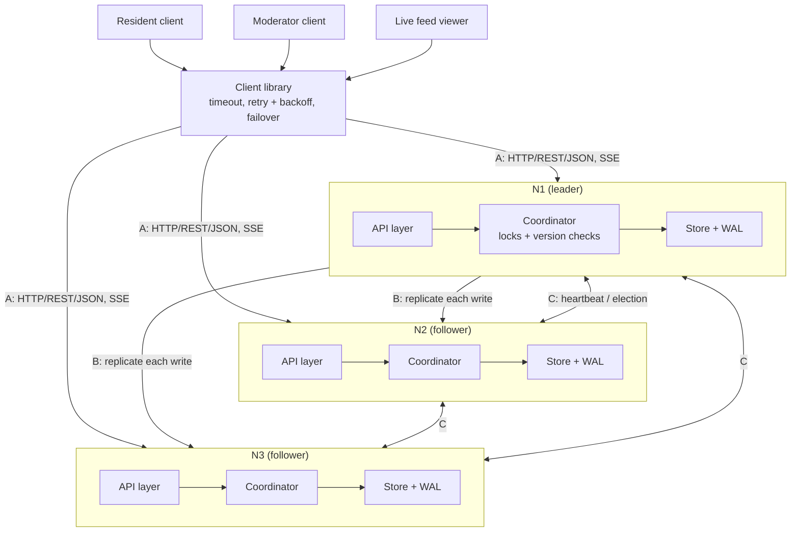

# Report skeleton (5-8 pages), evidence map and split of work

Everything below points at something that already exists in the repo, so the report can be written
from real results. Student A = **cluster side**, Student B = **client / API side** (swap names as you like).

## 1. Requirements -> where each one is met and shown

| # | Requirement | Implementation | Test evidence | Demo step |
|---|---|---|---|---|
| FR1 | Submit a report | `store.create_report`, `POST /reports` | stage1 `test_submit_and_get` | demo 1 |
| FR2 | Retrieve / filter from any node | `store.list_reports`, `GET /reports?...` | stage1 `test_filter`, stage3 replication tests | demo 4 |
| FR3 | Update, rejecting conflicts | per-record lock + `base_version` -> 409 (`store.update_report`) | stage2 two-thread and 10-thread races | demo 3 |
| FR4 | Push changes to viewers live | SSE `/events`, `feed.py`, `web/live.html` | stage5 (follower viewer, filters, replay, failover) | demo 1-2, browser |
| FR5 | Keep serving when a node fails | heartbeats + election + client failover (`node.py`, `client.py`) | stage4 election / failover / no-loss tests; failure benchmark | demo 5 |
| FR6 | Recover a restarted node from its log | WAL replay + catch-up + divergence resync | stage4 restart + divergence tests; failure benchmark | demo 6-7 |

## 2. Suggested report structure (page budget)

| Section | Pages | Content | Take it from |
|---|---:|---|---|
| 1 Introduction and requirements | 0.5 | the problem, three user types, FR1-FR6, constraints (stdlib only, 3 nodes) | table above |
| 2 Architecture | 1 | the diagram (below), components per node, the three links A/B/C, data model | README "Architecture" |
| 3 Implementation | 1.5 | WAL format and the rule "log first, then memory, then ack"; store; REST + SSE; client library; keep-alive pool | `wal.py`, `store.py`, `server.py`, `client.py` |
| 4 Coordination (part c) | 1.5 | forwarding, per-record lock, version check and 409, **synchronous majority replication and its trade-off**, in-order apply on followers, read staleness | README "Coordination"; stage2/3 tests |
| 5 Fault handling (part d) | 1.5 | heartbeat 1 s / dead 3 s, lowest-ID election, terms, catch-up before leading, client timeout/retry/backoff/failover, restart replay + catch-up, divergence | README "Fault handling"; stage4 tests; `failover_timeline.png` |
| 6 Performance evaluation | 1 | the load table, the failure table, three charts, **the port-exhaustion finding and fix**, submit-vs-update finding | `results/*.md`, `results/*.png` |
| 7 Limits and conclusion | 0.5 | tolerates 1 of 3; split-brain; not Raft/Paxos; no auth; 3.3 s failover (a single client may wait ~5 s); creates serialize | README "Limits" |

Figures to include: architecture diagram, `failover_timeline.png`, `load_latency.png`,
`load_throughput.png`, `failover_trials.png` (optional: `load_success.png`). Tables: load, failure, test summary
(`results/test_results.txt`).

## 3. Architecture diagram (redraw cleanly in the report; Mermaid source)

## 4. Walkthrough of one write (good for a sequence diagram)

Resident -> N3 `PATCH /reports/R1 {base_version: 2}` -> N3 forwards to leader N1 -> N1 takes R1's lock -> version
check passes -> version 3 -> append to WAL (fsync) -> send to N2 and N3 in parallel -> first follower ack
(majority 2 of 3) -> N1 replies 200 -> N3 relays it -> the SSE event is published on every node as it applies the
entry. If the base version were stale: N1 replies 409 + current version, and nothing is written.

## 5. Split of work per stage (what each student can demo and explain)

| Stage | Student A (cluster side) | Student B (client / API side) |
|---|---|---|
| 1 Single node | `wal.py`, `store.py`: log before memory, fsync, replay rebuilds state | `server.py` routes and status codes, `client.py`, CLI, stage 1 tests |
| 2 Locks + versions | lock design: per-record locks, lock order, check + write under one lock, why 409 | the 409 contract (`current_version` returned), CLI conflict demo, retry-after-409 test |
| 3 Replication | `node.py` replicate: synchronous majority and the trade-off, in-order apply, identical-WAL test | follower forwarding + relayed 409, `config.json`, three-terminal demo, read-staleness caveat |
| 4 Fault tolerance | heartbeats, terms, election, catch-up before leading, divergence resync, cluster tests | client timeout / backoff / failover, WAL torn-tail repair and restart replay, restart demo |
| 5 Live feed | `feed.py`, `_stream_events`: subscribe-then-replay, ordering, slow viewers dropped | `LiveFeed`, `cli watch`, `live.html` (EventSource, failover, XSS-safe rendering), browser demo |
| 6 Benchmarks | `failure_test.py`, `proc_cluster.py`: how outage/election/recovery are measured, zero-lost-writes check | `load_test.py`, `netutil.py`: operation mix, why 409 counts as success, the port-exhaustion bug story |
| 7 Docs | architecture, coordination, fault-handling sections; `demo.py` steps 5-7 | implementation, performance, limits sections; `demo.py` steps 1-4; README run instructions |

## 6. Video plan (max 15 min, each member visible and speaking)

| Time | Who | What |
|---:|---|---|
| 0:00-1:00 | both | the problem and the architecture diagram |
| 1:00-4:00 | B | `python3 demo.py --pause` steps 1-4: submit via follower, update, **409**, reads on all nodes, live viewer |
| 4:00-5:30 | B | browser live feed; client library behaviour (retries, failover) in the code |
| 5:30-9:00 | A | demo steps 5-7: kill leader, election log lines, client failover time, restart + catch-up, identical WALs |
| 9:00-11:00 | A | code: lock + version check, synchronous majority replication and its trade-off, terms |
| 11:00-13:00 | B | load results and charts, the port-exhaustion finding, `python3 run_tests.py` (46/46) |
| 13:00-14:30 | both | limits (split-brain, not Raft, no auth) and one improvement each |
| 14:30-15:00 | both | wrap-up |

## 7. Final checklist

- [ ] `python3 run_tests.py` -> 46/46, keep `results/test_results.txt`
- [ ] `python3 demo.py` runs on the demo laptop (ports 8001-8003 free)
- [ ] screenshots: browser live feed (before/after a kill), `results/*.png`, test summary
- [ ] report 5-8 pages with the sections above; both names on it
- [ ] video <= 15 min, both members present and explaining their own parts
- [ ] source zipped without `.venv-charts/` and `data/`
